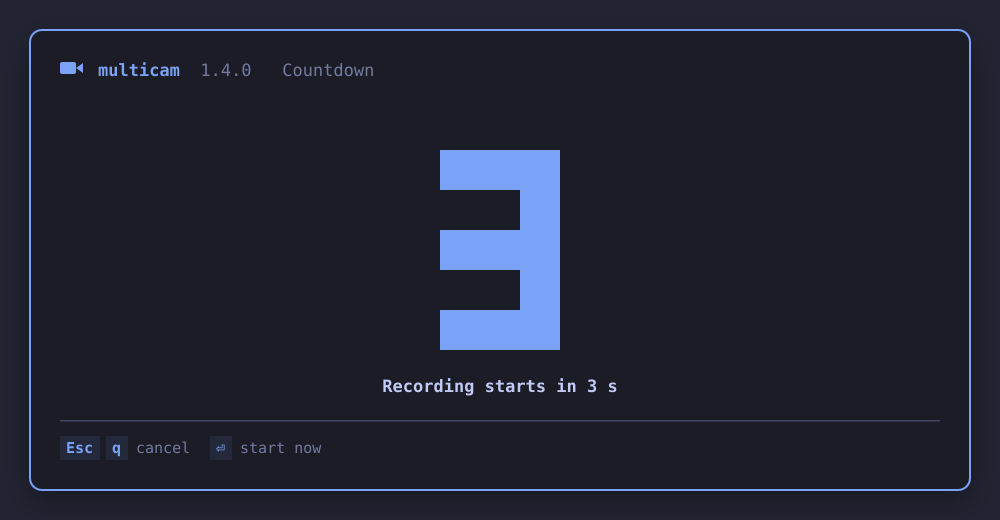
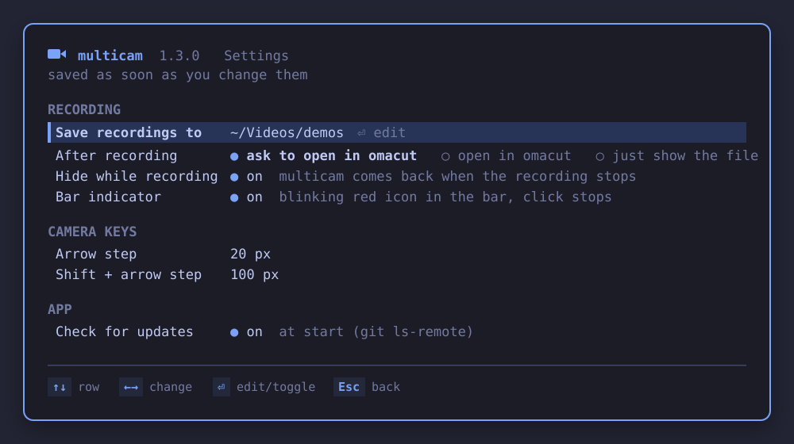

# multicam

A small keyboard-driven TUI for [Omarchy](https://omarchy.org) (Hyprland, Arch Linux) that records
the screen, up to two camera overlays and a chosen microphone into a plain MP4.
Cameras are floating windows (rectangle or circle, optional coloured ring) that you move and
resize with the keyboard. Recording is done by Omarchy's own `omarchy-capture-screenrecording`;
multicam only replaces its `--with-webcam` part. It takes its colours from the active Omarchy theme,
remembers all settings between runs, hides itself while recording and shows a blinking red icon in the bar.


<sub>Illustrations, not screenshots.</sub>

## Requirements

Required: `hyprctl`, `jq`, `mpv`, `pactl`, `gpu-screen-recorder` and Omarchy's `omarchy-capture-screenrecording`,
`omarchy-capture-region`, `omarchy-launch-tui` (all part of a normal Omarchy install; multicam stops with
"multicam needs Omarchy" if one of the Omarchy scripts is missing).
Optional: `v4l2-ctl` (picks camera resolution), `hyprpicker` (colour picker), `omacut` (open result),
`ffmpeg` (cropping when following a window), `python3` + `curl` (background-removal add-on), `git` (update check).
`install.sh` never uses root or the package manager; the AUR package is the system-wide alternative.

## Install

Two ways; use one, not both (`install.sh` refuses when the package is installed).

### From the AUR (system-wide)

Once the package is published (the PKGBUILD is in [packaging/aur/](packaging/aur/)):

```
yay -S multicam
```

This installs `/usr/bin/multicam`, `/usr/share/multicam/` (`lib/bg.py` and the bar plugin files), the app menu entry
and the icon. A package cannot write to your home folder, so the per-user parts are set up by multicam itself:

- the [bar indicator](#bar-indicator) is installed and enabled at the first start of multicam (once; if you remove it
  with `multicam setup-bar --remove`, it stays removed);
- the keybind is optional: `multicam setup-keybind` adds `SUPER + ALT + M`;
- the background-removal add-on: `multicam install-bgremove` (or the Background removal row in the app).

### Per user with install.sh (no root)

One line:

```
curl -fsSL https://raw.githubusercontent.com/mattische/multicam/main/install.sh | bash
```

Flags go after `bash -s --`, e.g. `curl -fsSL … | bash -s -- --yes --keybind`. The script clones the repository into a
temporary folder, installs from there and removes the folder again; questions are asked on the terminal as usual.

From a clone:

```
git clone https://github.com/mattische/multicam.git && cd multicam && ./install.sh
```

Options (same for both ways):

```
./install.sh                  # asks about the optional keybind
./install.sh --yes            # no questions, no keybind
./install.sh --keybind        # also add SUPER + ALT + M to ~/.config/hypr/bindings.lua
./install.sh --no-bgremove    # skip the background-removal add-on (~300 MB)
./install.sh --no-bar-indicator  # skip the bar plugin (blinking red icon while recording)
```
The background-removal add-on (transparent camera background) is installed by default; `--no-bgremove` skips it.
If it cannot be installed (e.g. offline), the installation still completes and the add-on can be installed later, see
[Background-removal add-on](#background-removal-add-on). `--no-keybind` answers "no" without asking. The installer remembers the git revision and the
repository it came from, so the app can find updates (see [Updating](#updating)).

Files created (and nothing else):
`~/.local/bin/multicam`, `~/.local/share/multicam/` (program, `lib/bg.py`, the bar plugin files),
`~/.config/multicam/`, `~/.local/share/applications/multicam.desktop`,
`~/.local/share/icons/hicolor/scalable/apps/multicam.svg` and the bar plugin
`~/.config/omarchy/plugins/io.github.mattische.multicam/` (installed with `multicam setup-bar`, see
[Bar indicator](#bar-indicator)). The keybind is one line ending in `-- multicam` (`multicam setup-keybind`).

Start it from the app menu ("Multicam"), with the keybind, or run `multicam`
(it opens in a floating terminal when launched through `omarchy-launch-tui --app-id=TUI.float multicam`).

### Bar indicator

A small Omarchy shell plugin (`io.github.mattische.multicam`, source in [`shell-plugin/`](shell-plugin/)) shows a
blinking red record icon with the elapsed time while multicam records; a click stops the recording. When not
recording it is hidden. To keep a record icon in the bar that opens multicam when clicked:

```
omarchy bar set io.github.mattische.multicam showWhenIdle true --json
```

```
multicam setup-bar            # copy the plugin into ~/.config/omarchy/plugins and enable it
multicam setup-bar --remove   # disable and delete it (remembered: neither the package nor an update adds it again)
```

`setup-bar` also disables and deletes the indicator of older multicam versions (`multicam.recording`), so there are
never two icons; other plugins are not touched. The `Bar indicator` setting (`S`) switches the icon off without
removing the plugin. The plugin is ready to be published on its own as an Omarchy plugin (installed with
`omarchy plugin add <repo>`), see [shell-plugin/README.md](shell-plugin/README.md) and [packaging/NOTES.md](packaging/NOTES.md).

## Uninstall

```
multicam uninstall      # or ./uninstall.sh ; asks first, --yes skips the question
```
Removes everything above, the keybind line, the bar plugin (also the old `multicam.recording`) and the add-on. Your
recordings are never touched.

For the AUR package `multicam uninstall` removes only the per-user files (settings, add-on, bar plugin, keybind) and
then prints the command for the rest: `sudo pacman -Rns multicam` (pacman never touches home folders).

## Updating

AUR package: `yay -Syu multicam` (with all other updates). `multicam update` and the `U` key do not update a
package; they show that command. The startup check compares the version with the newest `v*` release tag on GitHub
(`git ls-remote --tags`, needs `git`) and shows the command in a green line when a newer release exists.

install.sh:

```
multicam update         # compares with origin/main, asks, then installs the new version [--yes]
multicam check-update   # exit 0 if an update is available (for scripts)
```
At startup the app checks in the background (`git ls-remote`, nothing else is sent) whether `origin/main` is newer than
the installed revision. If so the form shows a green line and you can press `U` to update, or ignore it. `U` also
checks on demand. The update clones the repository into a temporary folder and runs its `install.sh --yes`;
your settings, the keybind, the bar plugin and the add-on are kept (an update never re-adds what you removed). After updating, restart multicam.
Turn the startup check off (both ways of installing) with `UPDATE_CHECK=off` in `~/.config/multicam/config` (or the
settings view) or `MULTICAM_NO_UPDATE_CHECK=1`.
The update source is the `origin` URL of the clone you installed from.

## Usage


1. Form: choose camera A / B (each "off" or a device; the same device cannot be used twice), shape, ring,
   ring colour and thickness, microphone, desktop audio and screen. Press `F5` (or Enter on the last row).
2. Preview: the cameras appear and are placed, nothing is recorded yet. Arrange them, then press `Enter` to start recording.
   By default a 3-second countdown with big digits runs first (`Esc` or `q` cancels back to the preview without
   recording, `Enter` starts at once; set 5 s, 10 s or off in the settings).

   

3. Recording: multicam's window disappears (it moves to a hidden workspace, `special:multicam`) before the recorder
   starts, so it is never in the recording (if the recorder fails to start it comes back with a message), and a blinking
   red record icon with the elapsed time appears in the bar. The camera windows stay.
4. Stop: click the red icon in the bar, press the keybind (`SUPER + ALT + M`) again, run `multicam stop`, or use
   Omarchy's own stop (Alt+Print). multicam comes back on the workspace you are on, shows the file name and (by
   default) offers to open it in omacut.



The result is `~/Videos/screenrecording-YYYY-MM-DD-HH_MM_SS.mp4` (h264 + AAC). Omarchy first writes
`screenrecording-YYYY-MM-DD_HH-MM-SS.mp4`; multicam renames it once Omarchy's post-processing is done
(`-2`, `-3`, ... on name collision). Choose another folder in the settings (`S`), or set `MULTICAM_OUTPUT_DIR`.
The selected microphone is set as default source only while recording and always restored afterwards.
"Screen" defaults to the focused monitor.

### Settings view



Press `S` in the form. Every change is saved at once to `~/.config/multicam/config`; `Esc` goes back.

| Setting | Values (default first) |
|---|---|
| Save recordings to | Omarchy's folder (`~/Videos`) or any folder you type (Enter edits, empty = default; created when needed) |
| After recording | ask to open in omacut, open in omacut, just show the file |
| Hide while recording | on, off |
| Bar indicator | on, off (the plugin stays installed; off means multicam does not show the icon; see [Bar indicator](#bar-indicator)) |
| Countdown | 3 s, 5 s, 10 s, off (before recording starts; `COUNTDOWN=off\|3\|5\|10`) |
| Follow window | on, off (window mode: the recording follows the window when it moves; `FOLLOW_WINDOW`) |
| Arrow step | 20 px (5-100) |
| Shift + arrow step | 100 px (25-400) |
| Check for updates | on, off |

### Settings are remembered

Everything you set is written to `~/.config/multicam/config` as soon as it changes (and again on exit), so the next
start opens with the same cameras, shapes, ring colours and thickness, background removal, microphone, desktop audio,
capture mode and screen. Camera positions and sizes are remembered separately for full screen and for area/window
recording (the latter relative to the area). In area mode the last area is remembered too: the form then shows an
`Area` row where you choose `last: WxH @ X,Y` (reused at `F5` without the picker, as long as it is on a connected screen)
or `pick a new one`. `o` in the preview always opens the picker. Saved devices that are not connected are shown as
missing and kept, never silently replaced.

### Look

The TUI follows the active Omarchy theme: accent, selection and text colours are read from
`~/.local/state/omarchy/current/theme/colors.toml` when it starts (without it, the terminal palette is used, which
Omarchy also themes). `NO_COLOR=1` turns colours off. The icon in the header needs a Nerd Font (Omarchy's default).

### What to record: full screen, area or window

The form row `Record` selects `full screen` (default), `area` (free rectangle) or
`window`. When you press `F5` in area/window mode, multicam first runs Omarchy's own picker
(`omarchy-capture-region region` / `windows`): drag a rectangle with the mouse, or for windows use
Tab / arrow keys and Enter (Esc cancels and returns to the form with a message; nothing is started).
The picked rectangle becomes the camera bounds, so cameras, snapping (1-9) and clamping always stay
inside the recorded area. The preview header shows `Area WxH @ X,Y` / `Window: class - title`.
Press `o` in the preview to pick again (cameras are re-clamped). The `Screen` row only applies to full screen.

How it works: the recording is still started by `omarchy-capture-screenrecording` (without `--fullscreen`);
multicam puts a tiny shim `omarchy-capture-region` first in `PATH` for that single start call, which answers with
the stored rectangle, so Omarchy records `-w region:WxH+X+Y` and does its normal finalize/stop. The shim is removed
right after start. The video has the physical size of the area (logical size x monitor scale, e.g. 1200x800 on
a 1.6 scale monitor gives 1920x1280).

Following a window (setting `Follow window`, on by default): in window mode multicam records the whole monitor the
window is on (Omarchy's monitor capture, native resolution), watches the window's position about ten times a second
while recording, and moves the camera overlays along so they keep their place on the window. When the recording stops,
the video is cropped to the window with ffmpeg (the crop position follows the logged positions, `sendcmd` + `crop`),
re-encoded with VAAPI `h264_vaapi` when available, otherwise `libx264 -preset veryfast -crf 18`; the audio is copied.
The file is replaced only when ffmpeg succeeds; otherwise the full-monitor recording is kept and the result screen says
so. multicam shows "Processing…" with a percentage meanwhile. The video has the window's size at start x the monitor
scale, like a fixed window recording. With `Follow window` off, the window is recorded as the fixed rectangle it had at start.

Limitations: free-drag area selection needs the mouse (like the colour picker); window selection works with the
keyboard. When following a window:
- processing takes roughly as long as the recording itself for a 4K monitor (the whole monitor is decoded);
- a resized window keeps the size it had at start (the crop does not grow or shrink);
- the crop is clamped to the monitor: a window dragged partly off the monitor, or onto another monitor, stays at the
  monitor edge (the cameras stay with the crop); a window that is closed keeps its last position;
- the crop follows the window's position, not its stacking: windows on top of it, or a workspace switch, are recorded
  as they appear on the monitor;
- if the window cannot be found when the recording starts, the fixed rectangle is recorded instead.
- Omarchy's "recording saved" notification thumbnail is made before cropping, so it shows the whole monitor.

### Keys


Form screen

| Key | Action |
|---|---|
| ↑ ↓ (k j) | previous / next row |
| ← → (h l), Enter | change value / toggle |
| `C` (or Enter on the colour row) | type a hex colour |
| `c` | colour picker (`hyprpicker`, needs a mouse click) |
| ← → on the colour row | cycle the 8 preset colours |
| `F5` | preview cameras |
| `S` | settings view |
| `U` | check for / install an update |
| ←/→ or Enter on `Area` | reuse the last area / pick a new one (area mode) |
| Enter on `Remove background` | install the background-removal add-on (when not installed) |
| `q`, `Esc` | quit |

Preview / recording screen

| Key | Action |
|---|---|
| `Tab` | select camera A / B |
| ↑ ↓ ← → | move 20 px (`[MOVE]`, set in settings) or grow/shrink ±10 % (`[SIZE]`: ↑ → bigger, ↓ ← smaller) |
| Shift + arrows | move 100 px (settings), or ±25 % in size mode |
| `m` | toggle move / size mode (shown in the status line) |
| `o` | pick the area / window again (area and window modes, not while recording) |
| `+` `-` / `PgUp` `PgDn` | size ±10 % around the centre (both modes) |
| `1`-`9` | snap to corner / edge / centre (numpad layout) |
| `s` | circle / rectangle |
| `r` | ring on / off |
| `p` / `P` | next / previous preset ring colour |
| `c` / `C` | colour picker / hex input |
| `[` `]` | ring thickness 1-12 px (default 4) |
| `b` | background removal on / off (add-on) |
| `Enter` | start recording (from preview; F5 does not start it) after the countdown; multicam then hides until the recording stops |
| `Esc`, `q` during the countdown | cancel, back to the preview (nothing is recorded); `Enter` skips the rest of the countdown |
| `q`, `Esc` | quit the preview (while recording, if the window is shown: stop, asks first) |

Deviation from the spec: the spec uses ← / → for the preset colours, but on the recording screen the
arrows move/resize. There the presets are on `p` / `P`; on the form screen ← / → work as specified.

Sizes: a circle is a square of the given size; a rectangle is 16:9 where the size is the height. Minimum
120 px, maximum the screen height. Cameras are always kept inside the screen.

Runtime files (PIDs, FIFOs, state) live in `$XDG_RUNTIME_DIR/multicam/` and vanish on logout.
Camera windows use 1280x720 (MJPEG when the device supports it at 30 fps), or 640x360/640x480 as fallback;
with background removal 640x360 is preferred to save CPU. Note that webcams with dynamic frame rate drop
to 15 fps in dim light regardless of format.

Cleanup: closing the terminal, Ctrl+C, `q`, stopping from outside (Alt+Print, click on the bar icon,
`omarchy-capture-screenrecording --stop-recording`) or killing `gpu-screen-recorder` all close the camera
windows, disable window rules and restore the microphone (a small watcher process handles the outside cases).
multicam only touches windows with class `MulticamA` / `MulticamB` and processes it started itself.

## Background-removal add-on

```
./install.sh                   # installed by default (skip with --no-bgremove) ...
multicam install-bgremove      # ... or any time later (also: select the "Remove background" row in the form and press Enter)
                               # ~300 MB Python venv + 14 MB model, all in ~/.local/share/multicam/bg/
multicam uninstall-bgremove    # removes that one folder
multicam check-bgremove        # verifies the model's SHA256
```
Camera -> ONNX Robust Video Matting (mobilenetv3) -> RGBA -> `mpv` with transparent background, 2 CPU
threads. The model (GPL-3.0, <https://github.com/PeterL1n/RobustVideoMatting>) is downloaded from the
project's release and checked against a fixed SHA256; on mismatch it is deleted and installation stops.
Quality: soft edges, dark clothes can become partly transparent (expected, not a bug). The per-camera
option appears in the form once the add-on is installed (until then the form shows an install row). Toggling it while running restarts that
camera window briefly.

## Known limitations

- Hyprland 0.56.2 with Lua config: only Lua dispatches are used; the window rule `rounding` is capped at 20,
  so circles are made with `set_prop rounding = size/2` after the window is mapped. Rounding cannot be read back.
- Omarchy's own stop (its bar icon / Alt+Print) only knows about `WebcamOverlay`; multicam's watcher
  cleans up the rest within about a second. Omarchy's stop also refuses to run when its `~/Videos` folder is
  missing; `multicam stop` and multicam's bar icon do not have that problem.
- While recording, multicam's window waits on the hidden workspace `special:multicam`; showing that workspace by
  hand would put it in the recording.
- Omarchy's "recording saved" notification points to the original file name, which multicam renames.
- A recording managed by Omarchy and one by multicam cannot run at the same time (multicam refuses to start).
- `--fullscreen` records the focused monitor; choosing another screen briefly focuses it when recording starts.
- `hyprpicker` needs a mouse click (keyboard alternatives: hex code, preset colours).
- A camera device can be opened by one process only; the same device cannot be used for both cameras.
- Screens that are blanked or locked deliver no frames: the recording then contains the lock screen.
- Tested on foot-based Omarchy only; the TUI needs about 100x30 terminal cells.

## Tests

`tests/run.py [T-ID ...]` runs the automatic tests (pty driving, `hyprctl clients -j`, `ffprobe`); results and
evidence are summarised in `docs/TEST-REPORT.md`. Tests record into a scratch directory via `MULTICAM_OUTPUT_DIR`
and run with no update check. Install tests use `--no-bgremove --no-bar-indicator` so they never download the
add-on or touch the running Omarchy shell. A quick subset after UI changes:
`tests/run.py T-L1 T-S1 T-H1 T-B2 T-B4 T-B5 T-B6c T-B6d T-B7` (about 2 minutes).
`tests/features.py` tests the countdown and window following (about 3 minutes).
Devices are autodetected (first two cameras, first two non-monitor microphones); override with `MC_CAM_A_DEV`,
`MC_CAM_A_NAME`, `MC_CAM_B_DEV`, `MC_CAM_B_NAME`, `MC_MIC`, `MC_MIC2` (T-C3v needs two mics), `MC_SCRATCH`.
