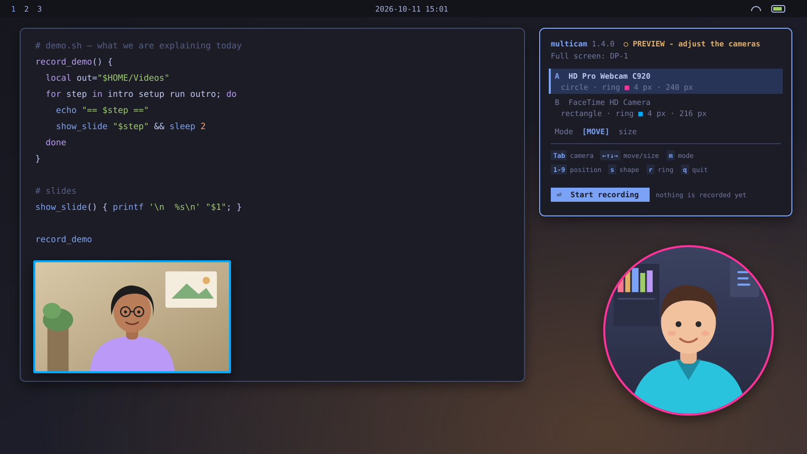
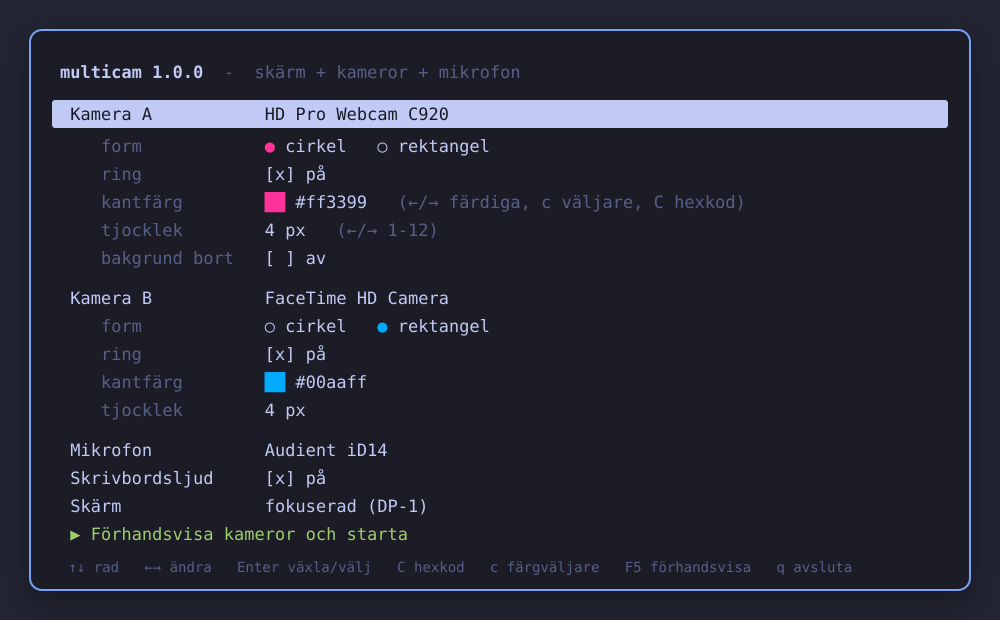
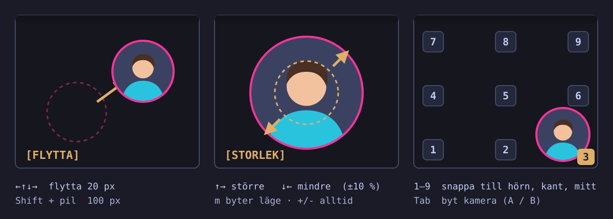

# multicam

A small keyboard-driven TUI for [Omarchy](https://omarchy.org) (Hyprland, Arch Linux) that records
the screen, up to two camera overlays and a chosen microphone into a plain MP4.
Cameras are floating windows (rectangle or circle, optional coloured ring) that you move and
resize with the keyboard. Recording is done by Omarchy's own `omarchy-capture-screenrecording`;
multicam only replaces its `--with-webcam` part. The UI text is Swedish.



<sub>Illustrations, not screenshots.</sub>

## Requirements

Required: `hyprctl`, `jq`, `mpv`, `pactl`, `gpu-screen-recorder`, `omarchy-capture-screenrecording`,
`omarchy-launch-tui` (all part of a normal Omarchy install).
Optional: `v4l2-ctl` (picks camera resolution), `hyprpicker` (colour picker), `omacut` (open result),
`python3` + `curl` (background-removal add-on).
Nothing is ever installed with root or through the package manager.

## Install

The repository is private; you need `gh`/ssh access to `mattische/multicam`:

```
git clone git@github.com:mattische/multicam.git && cd multicam && ./install.sh
```

Options:

```
./install.sh            # asks whether to add the optional keybind
./install.sh --yes      # no questions, no keybind
./install.sh --keybind  # also add SUPER + ALT + M to ~/.config/hypr/bindings.lua
```

Files created (and nothing else):
`~/.local/bin/multicam`, `~/.local/share/multicam/`, `~/.config/multicam/`,
`~/.local/share/applications/multicam.desktop`. The keybind is one line ending in `-- multicam`.
Start it from the app menu ("Multicam"), with the keybind, or run `multicam`
(it opens in a floating terminal when launched through `omarchy-launch-tui --app-id=TUI.float multicam`).

## Uninstall

```
multicam uninstall      # or ./uninstall.sh ; asks first, --yes skips the question
```
Removes everything above, the keybind line and the add-on. Your recordings are never touched.

## Usage



1. Form: choose camera A / B (each "av" or a device; the same device cannot be used twice), shape, ring,
   ring colour and thickness, microphone, desktop audio and screen. Press `F5` (or Enter on the last row).
2. Preview: the cameras appear and are placed, nothing is recorded yet. Arrange them, then press `Enter` to start recording.
3. While recording the same keys work. `q`/`Esc` asks for confirmation, stops, shows the file name and
   offers to open it in omacut.

The result is `~/Videos/screenrecording-YYYY-MM-DD-HH_MM_SS.mp4` (h264 + AAC). Omarchy first writes
`screenrecording-YYYY-MM-DD_HH-MM-SS.mp4`; multicam renames it once Omarchy's post-processing is done
(`-2`, `-3`, ... on name collision). Set `MULTICAM_OUTPUT_DIR` to write somewhere else.
The selected microphone is set as default source only while recording and always restored afterwards.
"Screen" defaults to the focused monitor.

### What to record: full screen, area or window

The form row `Spela in` selects `hel skärm` (full screen, default), `område` (free rectangle) or
`fönster` (a window). When you press `F5` in area/window mode, multicam first runs Omarchy's own picker
(`omarchy-capture-region region` / `windows`): drag a rectangle with the mouse, or for windows use
Tab / arrow keys and Enter (Esc cancels and returns to the form with a message; nothing is started).
The picked rectangle becomes the camera bounds, so cameras, snapping (1-9) and clamping always stay
inside the recorded area. The preview header shows `Område WxH @ X,Y` / `Fönster: class - title`.
Press `o` in the preview to pick again (cameras are re-clamped). The `Skärm` row only applies to full screen.

How it works: the recording is still started by `omarchy-capture-screenrecording` (without `--fullscreen`);
multicam puts a tiny shim `omarchy-capture-region` first in `PATH` for that single start call, which answers with
the stored rectangle, so Omarchy records `-w region:WxH+X+Y` and does its normal finalize/stop. The shim is removed
right after start. The video has the physical size of the area (logical size x monitor scale, e.g. 1200x800 on
a 1.6 scale monitor gives 1920x1280).

Limitations: a window is recorded as the rectangle it had at start; if you move the window the recording does
not follow. Free-drag area selection needs the mouse (like the colour picker); window selection works with the keyboard.

### Keys



Form screen

| Key | Action |
|---|---|
| ↑ ↓ (k j) | previous / next row |
| ← → (h l), Enter | change value / toggle |
| `C` (or Enter on the colour row) | type a hex colour |
| `c` | colour picker (`hyprpicker`, needs a mouse click) |
| ← → on the colour row | cycle the 8 preset colours |
| `F5` | preview cameras |
| `q`, `Esc` | quit (settings are saved) |

Preview / recording screen

| Key | Action |
|---|---|
| `Tab` | select camera A / B |
| ↑ ↓ ← → | move 20 px (`[FLYTTA]`) or grow/shrink ±10 % (`[STORLEK]`: ↑ → bigger, ↓ ← smaller) |
| Shift + arrows | move 100 px, or ±25 % in size mode |
| `m` | toggle move / size mode (shown in the status line) |
| `o` | pick the area / window again (area and window modes, not while recording) |
| `+` `-` / `PgUp` `PgDn` | size ±10 % around the centre (both modes) |
| `1`-`9` | snap to corner / edge / centre (numpad layout) |
| `s` | circle / rectangle |
| `r` | ring on / off |
| `p` / `P` | next / previous preset ring colour |
| `c` / `C` | colour picker / hex input |
| `[` `]` | ring thickness 1-12 px (default 4) |
| `b` | background removal on / off (add-on) |
| `Enter` | start recording (from preview; F5 does not start it) |
| `q`, `Esc` | stop (asks first) and quit |

Deviation from the spec: the spec uses ← / → for the preset colours, but on the recording screen the
arrows move/resize. There the presets are on `p` / `P`; on the form screen ← / → work as specified.

Sizes: a circle is a square of the given size; a rectangle is 16:9 where the size is the height. Minimum
120 px, maximum the screen height. Cameras are always kept inside the screen.

Runtime files (PIDs, FIFOs, state) live in `$XDG_RUNTIME_DIR/multicam/` and vanish on logout.
Camera windows use 1280x720 (MJPEG when the device supports it at 30 fps), or 640x360/640x480 as fallback;
with background removal 640x360 is preferred to save CPU. Note that webcams with dynamic frame rate drop
to 15 fps in dim light regardless of format.

Cleanup: closing the terminal, Ctrl+C, `q`, stopping from outside (Alt+Print, click on the bar icon,
`omarchy-capture-screenrecording --stop-recording`) or killing `gpu-screen-recorder` all close the camera
windows, disable window rules and restore the microphone (a small watcher process handles the outside cases).
multicam only touches windows with class `MulticamA` / `MulticamB` and processes it started itself.

## Background-removal add-on

```
multicam install-bgremove      # ~300 MB Python venv + 14 MB model, all in ~/.local/share/multicam/bg/
multicam uninstall-bgremove    # removes that one folder
multicam check-bgremove        # verifies the model's SHA256
```
Camera -> ONNX Robust Video Matting (mobilenetv3) -> RGBA -> `mpv` with transparent background, 2 CPU
threads. The model (GPL-3.0, <https://github.com/PeterL1n/RobustVideoMatting>) is downloaded from the
project's release and checked against a fixed SHA256; on mismatch it is deleted and installation stops.
Quality: soft edges, dark clothes can become partly transparent (expected, not a bug). The per-camera
option appears in the form only when the add-on is installed. Toggling it while running restarts that
camera window briefly.

## Known limitations

- Hyprland 0.56.2 with Lua config: only Lua dispatches are used; the window rule `rounding` is capped at 20,
  so circles are made with `set_prop rounding = size/2` after the window is mapped. Rounding cannot be read back.
- Omarchy's own stop (bar click / Alt+Print) only knows about `WebcamOverlay`; multicam's watcher
  cleans up the rest within about a second.
- Omarchy's "recording saved" notification points to the original file name, which multicam renames.
- A recording managed by Omarchy and one by multicam cannot run at the same time (multicam refuses to start).
- `--fullscreen` records the focused monitor; choosing another screen briefly focuses it when recording starts.
- `hyprpicker` needs a mouse click (keyboard alternatives: hex code, preset colours).
- A camera device can be opened by one process only; the same device cannot be used for both cameras.
- Screens that are blanked or locked deliver no frames: the recording then contains the lock screen.
- Tested on foot-based Omarchy only; the TUI needs about 100x30 terminal cells.

## Tests

`tests/run.py [T-ID ...]` runs the automatic tests (pty driving, `hyprctl clients -j`, `ffprobe`); results and
evidence are summarised in `docs/TEST-REPORT.md`. Tests record into a scratch directory via `MULTICAM_OUTPUT_DIR`.
